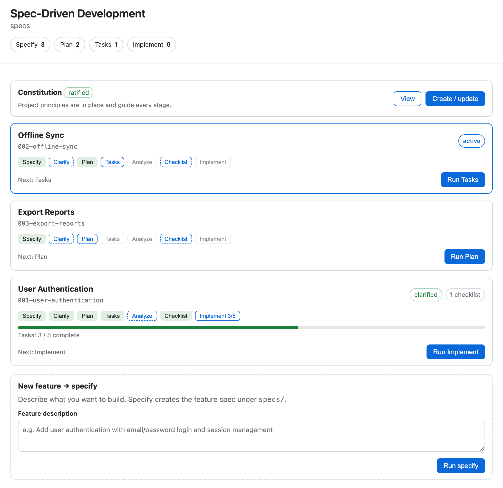
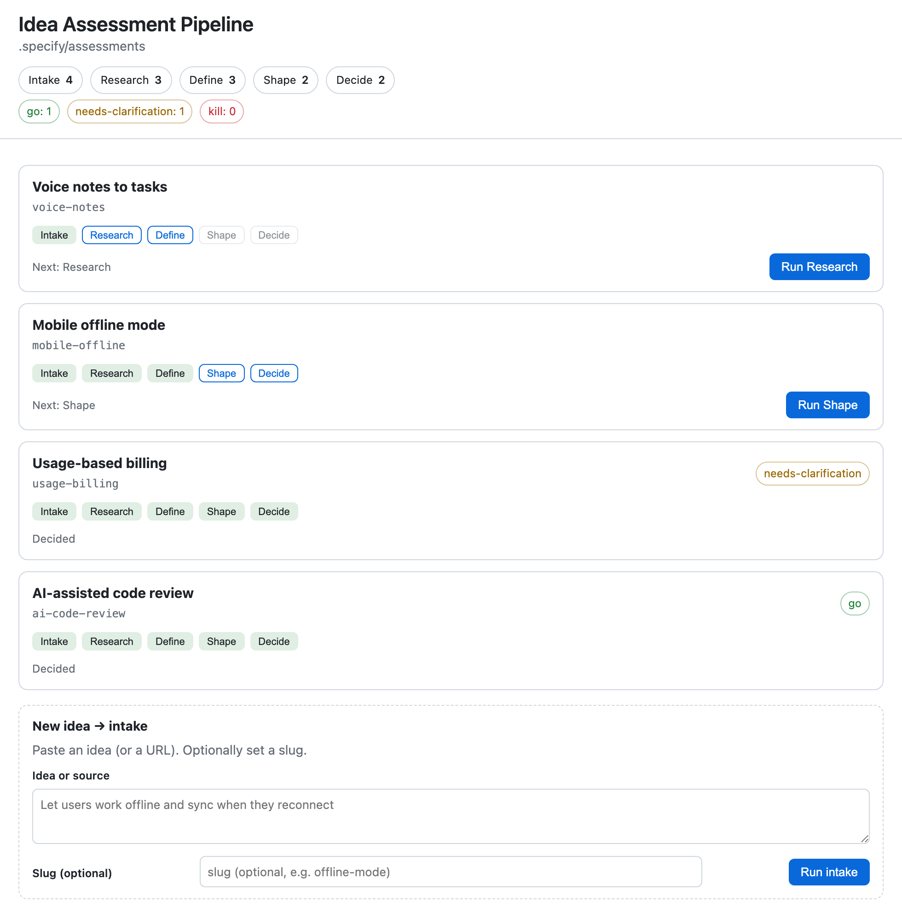
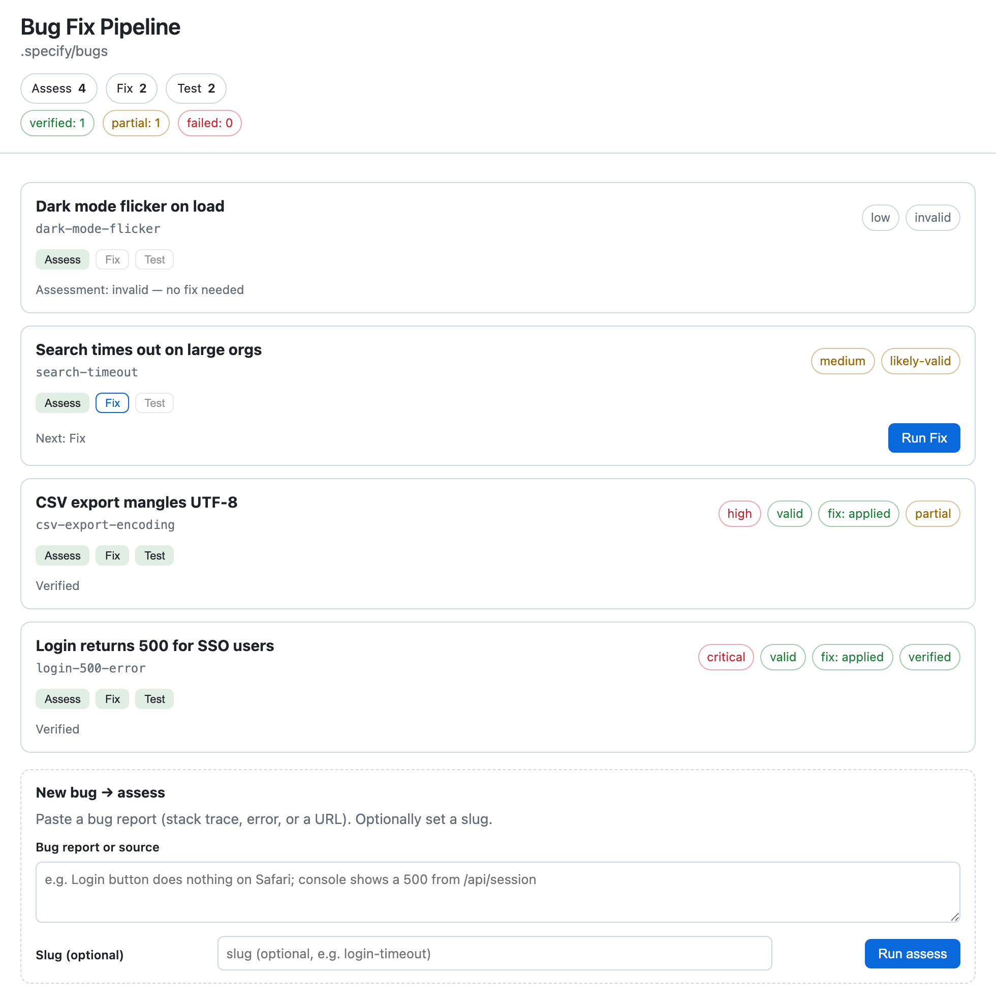
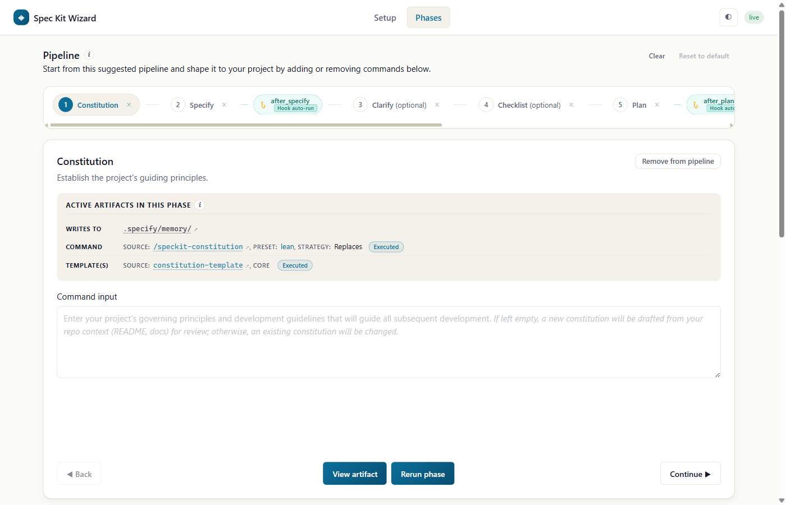

# Spec Kit for GitHub Copilot

**Copilot-native integrations for Spec Kit across GitHub Copilot CLI, the Copilot
App, and VS Code.**

This repository hosts Copilot-specific integrations and Spec Kit components tailored
for Copilot: CLI skills, App canvases, and future plugins, hooks, or workflow surfaces.
Spec Kit remains agent-agnostic; this companion repository provides the first-class
Copilot experience around it.

**Status:** active development.

## Local Wizard configuration and distribution

Runtime settings and distribution metadata are separate. Runtime settings select
catalogs and the initial Generate flag without reinstalling provider code;
marketplace/catalog distribution preparation changes local install metadata,
not the configuration of a running Wizard.

### Runtime settings

The packaged defaults live in the Wizard provider at
`config/runtime-defaults.json`. The optional desktop override is
`%USERPROFILE%\.copilot\spec-kit\runtime-settings.json` (the home-directory
equivalent on other platforms). `SPECKIT_CONFIG_FILE` selects an **absolute**
JSON file exclusively; it is not merged with the desktop file. There are no
per-value environment overrides. Malformed/unknown settings, invalid HTTPS
catalog URLs and explicit missing files fail visibly. Only an absent optional
desktop file selects defaults.

From the current worktree, using PowerShell:

```powershell
node dev-tools\configure-runtime.mjs show
node dev-tools\configure-runtime.mjs use-fork
# Review the diff and effective settings; then use that preview's digest:
node dev-tools\configure-runtime.mjs use-fork --apply --expect "<preview expect digest>"
node dev-tools\configure-runtime.mjs use-defaults
node dev-tools\configure-runtime.mjs use-defaults --apply --expect "<new preview digest>"
```

`use-fork` uses `config\runtime-settings.fork.example.json`, merging its overrides
with other valid existing settings. Use `--source "<custom JSON>"` for custom
overrides, or `--file "<destination JSON>"` to preview/apply an explicit location.
`use-defaults` backs up the selected override and leaves `{}` rather than deleting
a file still referenced by an explicit selector. Replaced files receive dated
sibling backups. Writes require `--apply` and the matching `--expect` digest;
stale previews are rejected. Keep backups, but do not commit personal settings
or backup files.

Settings resolve at provider startup: reload/restart and verify **both** installed
providers after changes. A successful file write is not proof of reload. Prefer
the default user-level location for desktop/Designer children; do not assume a
shell's explicit selector is inherited by a child. Switching settings does not
undo locally refreshed provider code; explicitly reinstall/update from the
marketplace to restore published code.

### Project development skills

Canonical repository skills live in `.github\skills`, not the shipping core
`skills` plugin:

- `dev-tools-speckit-wizard-installed-refresh`: compare inventories, back up and hash-verify
  both installed providers from this worktree; configure settings only on request.
- `dev-tools-speckit-wizard-installed-open`: verify the exact installed plugin/provider and
  persisted disabled settings; ordinary opening uses the configured Generate
  default, explicit Generate requests enable it, focus-only reopening preserves it.
- `dev-tools-speckit-wizard-local-generate-launch`: refresh, then explicitly enable Generate;
  leave phase selection, Designer launch/settings and Generate submission to the user.
- `dev-tools-speckit-wizard-project-reset`: back up and clear a worktree's Spec Kit
  setup, generated skills, feature specs, and Wizard state for a fresh local test.
- `dev-tools-speckit-distribution`: prepare local metadata, orchestrate explicitly authorized
  releases, or verify published installations.

Use one active installed Wizard/Designer pair; sample/session previews are not
installed-provider or functional journey evidence. For local Generate testing,
approve **both** this worktree's `spec-kit-extensions\extension-canvas-design` and
`spec-kit-presets\copilot-vertical-phase-control` paths in Wizard Local development.
Verify actual child installations, resolved contributions and generated output
before claiming end-to-end success. Do not modify symlinked Specify development
installations.

Development helpers live in `dev-tools` and project development skills use the
`dev-tools-` prefix to distinguish them from shipping and personal skills.
Personal skills remain untouched. Run `/skills reload` and verify project discovery.

### Distribution and releases

Distribution configuration requires `copilotCatalogName` for the printed
extension/preset registration commands. Set it to the same registration name
as the runtime settings used for that distribution; preparation does not
change runtime settings or migrate existing registrations.

Metadata changes are staged before application. If an apply fails, earlier
writes are rolled back and the error lists retained backups. A rollback conflict
or filesystem failure is reported explicitly for manual recovery; this is not a
crash-safe transaction across files.
Staged-file cleanup attempts every file and reports cleanup failures alongside
the original apply/rollback error. Catalog refs must also pass local syntax
validation; preparation does not check whether the ref exists remotely.
On POSIX systems, backups and replacements retain the existing file's permission
bits. This helper does not manage Windows ACLs.

Select `config\distribution.upstream.example.json`,
`config\distribution.fork.example.json`, or custom JSON explicitly:

```powershell
node dev-tools\prepare-distribution.mjs --config config\distribution.fork.example.json
# Only after reviewing the affected-file diff:
node dev-tools\prepare-distribution.mjs --config config\distribution.fork.example.json --apply --expect "<preview expect digest>"
node --test tests\dev-tools\*.test.mjs
```

Configuration declares GitHub repository, catalog ref and marketplace display
metadata. Preparation derives catalog, documentation, installation and exact
versioned ZIP links. It changes only marketplace display fields, catalog self URLs,
and Canvas Design/vertical-control URL fields, preserving unrelated entries,
formatting, IDs, versions and requirements. Manifest/catalog version conflicts or
changed preview inputs stop the operation; overwritten files receive backups.
Printed marketplace/Specify commands are **not executed**. Preparation does not
publish catalogs, change workflows, commit, push, tag, or bump versions.

For an explicitly requested release, align only selected component versions and
metadata/docs, validate, and commit/push only with authorization. Reuse the existing
Release Extension Trigger and Release Preset Trigger from the prepared release
commit/ref; publisher validation requires asset URLs matching `GITHUB_REPOSITORY`.
Do not relocate unrelated upstream packages. Publish assets before promoting the
served catalog/marketplace ref; publishing a ZIP does not update hosted catalogs.
Never move an existing tag or replace a published ZIP for development testing.

Hosted readiness requires the **actual published archives selected by the served
catalogs**, installed without local-source overrides, and verified through
Wizard/Designer/generated output. Local-source success is separate evidence;
hosted incompatibility is a release-readiness concern, not a reason to routinely
bump versions or publish development edits.

> [!NOTE]
> **Experience visual, Copilot-interactive Spec Kit canvases**
>
> See how GitHub Copilot App's canvas functionality turns Spec Kit workflows into
> visual, Copilot-interactive experiences:
> [*Spec Kit Assess: Visual Idea Intake with GitHub Copilot*](https://youtu.be/eo1_QUZMYb0?si=dCjcCYXzWjpLPfKC)
> showcases the `assess` extension's five-stage discovery funnel — intake,
> research, define, shape, and decide — helping teams turn rough concepts into a
> clear go, needs clarification, or kill decision before moving into SDD.
>
> [*Spec Kit Wizard: Visual Spec-Driven Development with GitHub Copilot*](https://youtu.be/-yRdys89DtY?si=0XbgF8zy2Z6rBdgq)
> showcases a guided visual workflow for exploring, understanding, and running the
> full Spec-Driven Development lifecycle, plus discovering and applying
> customizations that tailor the workflow to your project.

## Background

[Spec Kit](https://github.com/github/spec-kit) provides the `specify` CLI and
agent-independent foundations for Spec-Driven Development. This repository packages
the integrations that are specifically useful to Copilot users without adding
Copilot-only behavior to the core Spec Kit project.

Contributions are welcome — see [CONTRIBUTING.md](CONTRIBUTING.md) to get started, and
[open issues](https://github.com/github/spec-kit-copilot/issues) for the current roadmap.

## Plugins

| Plugin | Version | Surface | Purpose |
| --- | --- | --- | --- |
| `spec-kit-copilot` | 0.16.0 | Copilot CLI and App agent | Core skills that teach Copilot how to run `specify` |
| `spec-kit-copilot-assess` | 0.1.0 | Copilot App canvas | Optional visual dashboard for the Spec Kit `assess` extension |
| `spec-kit-copilot-bugfix` | 0.1.0 | Copilot App canvas | Optional visual dashboard for the Spec Kit `bug` extension |
| `spec-kit-copilot-sdd` | 0.1.0 | Copilot App canvas | Optional visual dashboard for the core spec-driven development workflow |
| `spec-kit-copilot-wizard` | 0.4.25 | Copilot App canvases | Guided wizard and a composable Designer generator (under development) |

The plugins are independently installable and versioned. Install the core skills,
the assessment canvas, the bug fix canvas, the spec-driven development canvas, the
wizard canvas, or any combination.

## Spec Kit presets

This repo also hosts **shipping Copilot-specific Spec Kit presets** under
[`spec-kit-presets/`](spec-kit-presets). These are *not* Copilot plugins — they are
consumed by the **`specify` CLI** (`specify preset add`), and are kept in their own
isolated subtree (with their own `catalog.json`) so Spec Kit plumbing is never
confused with Copilot plugin/marketplace plumbing. Test-only presets live in
[`tests/fixtures/test-presets/`](tests/fixtures/test-presets/) instead.

| Preset | Requires | Copilot purpose |
| --- | --- | --- |
| [`copilot-lean-sdd`](spec-kit-presets/copilot-lean-sdd) | Spec Kit `>= 1.0.8`, Copilot skills mode | Upstream-derived minimal SDD baseline with Copilot skill invocation and interactive `ask_user`; nine hook-free command replacements. Initial release pending; use the documented local-development install. |
| [`copilot-sub-agents`](spec-kit-presets/copilot-sub-agents) | Spec Kit `>= 0.8.0` | Uses Copilot delegation — VS Code `runSubagent`, Copilot CLI sub-agents, `.github/agents/` |
| [`copilot-assess-ask-questions`](spec-kit-presets/copilot-assess-ask-questions) | Spec Kit `>= 0.9.0`, `assess` extension | Drives the assess pipeline through Copilot's interactive `ask_user` tool (no plain-text fallback) |
| [`copilot-vertical-phase-control`](spec-kit-presets/copilot-vertical-phase-control) | Spec Kit `>= 1.0.7`, `extension-canvas-design` | Replaces the generated phase control with the Copilot Autopilot workflow |
| [`copilot-extension-hooks`](spec-kit-presets/copilot-extension-hooks) | Specify `==1.2.3`, one compatible SDD baseline | Opt-in Specify extension lifecycle dispatch through Copilot skills; not native Copilot hooks |

See [`spec-kit-presets/README.md`](spec-kit-presets/README.md) for the plumbing
boundary, install commands, and versioning. Shipping presets and extensions must
depend on Copilot-specific mechanisms. See
[contribution scope and placement](CONTRIBUTING.md#scope-and-package-placement).

## Core skills plugin

`spec-kit-copilot` gives Copilot focused skills—one per `specify` command group—so
the agent knows when and how to drive the CLI on your behalf.

| Skill | Wraps | Purpose |
| --- | --- | --- |
| `speckit-cli-setup` | install / `specify --version` | Detect and install the `specify` CLI the other skills depend on |
| `speckit-init` | `specify init` | Scaffold a new Copilot spec-driven project (or `--here`) |
| `speckit-check` | `specify check`, `specify version` | Verify tools, report version/features |
| `speckit-extension` | `specify extension …` | Install/update/search spec-kit extensions (+ catalogs) |
| `speckit-preset` | `specify preset …` | Install/search/resolve presets (+ catalogs) |
| `speckit-artifact` | `specify artifact …` | Inspect commands, templates, scripts, hooks, and their composition stacks |
| `speckit-bundle` | `specify bundle …` | Discover, install, update, and author bundles (+ catalogs) |
| `speckit-workflow` | `specify workflow …` | Run/resume/inspect automation workflows (+ catalogs) |
| `speckit-workflow-step` | `specify workflow step …` | Manage workflow step types (+ catalogs) |
| `speckit-self` | `specify self …` | Check for and apply CLI upgrades |

Each skill is a `SKILL.md` (YAML frontmatter + Markdown body). The `description`
field tells Copilot when to load the skill; the body documents the exact `specify`
sub-commands, options, and usage notes. The plugin is described by the
[`plugin.json`](plugin.json) manifest at the repository root.

## Canvases

Optional Copilot **App** canvas plugins render a side-panel dashboard for a Spec Kit
workflow. Each has its own plugin manifest and release cadence, is not enabled by
installing the core skills, and rides the experimental canvas SDK. See each canvas's
own README for full details.

| Canvas | Plugin | What it does |
| --- | --- | --- |
| [`assess-canvas`](plugins/spec-kit-copilot-assess/extensions/assess-canvas/README.md) | `spec-kit-copilot-assess` | Dashboard for the optional `assess` extension — the intake → research → define → shape → decide funnel. |
| [`bugfix-canvas`](plugins/spec-kit-copilot-bugfix/extensions/bugfix-canvas/README.md) | `spec-kit-copilot-bugfix` | Dashboard for the optional `bug` extension — the assess → fix → test triage pipeline. |
| [`sdd-canvas`](plugins/spec-kit-copilot-sdd/extensions/sdd-canvas/README.md) | `spec-kit-copilot-sdd` | Dashboard for the core spec-driven workflow — constitution → specify → clarify → plan → tasks → analyze → checklist → implement. |
| [`speckit-wizard-canvas`](plugins/spec-kit-copilot-wizard/extensions/speckit-wizard-canvas/README.md) | `spec-kit-copilot-wizard` | Guided wizard for the full Spec Kit lifecycle — setup → constitution → specify → clarify → plan → tasks → analyze → checklist → implement, with preset / extension / composition inspectors. |
| [`speckit-canvas-designer`](plugins/spec-kit-copilot-wizard/extensions/speckit-canvas-designer/README.md) | `spec-kit-copilot-wizard` | Under development; not ready for use. Direct opening shows only an empty shell. |

The Designer's Generate action freezes Essentials and the Wizard handoff, then
the Canvas Design extension copies its maintained SDK entry point and workflow
modules into a **new** project extension directory, then validates it in place.
It no longer invokes `create-canvas` or overwrites a generated canvas. To
propagate generator changes to an existing canvas in a Designer session, use
the project-local `refresh-generated-canvas` skill in `.github/skills/`, which
checks the target and merges user changes rather than blindly copying files. See
the [Canvas Design generation details](spec-kit-extensions/extension-canvas-design/README.md#how-it-works).

### Previews

| Spec-Driven Development | Idea Assessment |
| --- | --- |
| [](docs/images/sdd-canvas.png) | [](docs/images/assess-canvas.png) |

| Bug Fix | Spec Kit Wizard |
| --- | --- |
| [](docs/images/bugfix-canvas.png) | [](docs/images/wizard-phases.png) |


## Requirements

- [GitHub Copilot CLI](https://docs.github.com/en/copilot/concepts/agents/copilot-cli/about-copilot-cli)
- Copilot CLI 1.0.71 or later when installing `spec-kit-copilot-assess`
- The Spec Kit `specify` CLI on your `PATH`:

  ```bash
  uv tool install specify-cli      # or: pipx install specify-cli
  specify --version
  ```

> **Versioning:** each plugin has an independent version and is not pinned to a
> specific Specify CLI version. The core plugin targets the **latest** `specify`
> published on PyPI (package `specify-cli`), with a
> minimum floor of **>= 0.11** for the `bundle` / `workflow step` skills and
> **>= 1.0.7** for the `artifact` skill and preset/extension JSON inventory. Install or
> upgrade with `uv tool install specify-cli` / `uv tool upgrade specify-cli` (or the
> `pipx` equivalents), or `specify self upgrade`. Each plugin's own `version` is
> independent of the CLI version. A plugin's manifest and marketplace entry
> must match; marketplace metadata is versioned separately when the catalog changes.

## Installation

### Via marketplace (recommended)

This repository ships a marketplace manifest at
[`.github/plugin/marketplace.json`](.github/plugin/marketplace.json). Register the
marketplace, then install any combination of the plugins:

```bash
copilot plugin marketplace add https://github.com/nicolehaugen/spec-kit-copilot.git#staging-canvas
copilot plugin install spec-kit-copilot@spec-kit-staging
copilot plugin install spec-kit-copilot-assess@spec-kit-staging
copilot plugin install spec-kit-copilot-bugfix@spec-kit-staging
copilot plugin install spec-kit-copilot-sdd@spec-kit-staging
copilot plugin install spec-kit-copilot-wizard@spec-kit-staging
```

This fork's staging marketplace is served from `staging-canvas`; the default-branch
marketplace is separate. Disable other installed Wizard providers while testing;
the plugin and canvas IDs intentionally remain unchanged. The staging catalogs
resolve to this fork's published release ZIPs.

### Local development loading

Load any of the plugins directly from a checkout while iterating:

```bash
copilot --plugin-dir . plugin list
copilot --plugin-dir plugins/spec-kit-copilot-assess plugin list
copilot --plugin-dir plugins/spec-kit-copilot-bugfix plugin list
copilot --plugin-dir plugins/spec-kit-copilot-sdd plugin list
copilot --plugin-dir plugins/spec-kit-copilot-wizard plugin list
```

Verify it loaded:

```bash
copilot plugin list
# or, inside an interactive session:
/skills list
```

For a persistent branch install, use `OWNER/REPO` for the core plugin or
`OWNER/REPO:plugins/spec-kit-copilot-assess` for the canvas plugin.

Uninstall with the plugin's `name` (from `plugin.json`), not its path:

```bash
copilot plugin uninstall spec-kit-copilot
copilot plugin uninstall spec-kit-copilot-assess
copilot plugin uninstall spec-kit-copilot-bugfix
copilot plugin uninstall spec-kit-copilot-sdd
copilot plugin uninstall spec-kit-copilot-wizard
```

## Usage

Just talk to Copilot in natural language; it selects the matching skill and runs the
right `specify` command. For example:

- "Initialize a spec-kit project here for Copilot" → `speckit-init`
- "Check my spec-kit environment" → `speckit-check`
- "Add the git extension" → `speckit-extension`
- "Run the taskstoissues workflow" → `speckit-workflow`
- "Install the platform-starter bundle" → `speckit-bundle`
- "Is there a newer specify release?" → `speckit-self`

### Opening a canvas dashboard

The **Assessment canvas**, **Bug fix canvas**, **Spec-driven development
canvas**, and **Spec Kit Wizard** plugins are *canvas extensions*: they
render in the **GitHub Copilot app** side panel, not the terminal CLI.
Installing one only registers its canvas — nothing opens automatically.
To open a dashboard, ask Copilot, e.g. **"Open the Idea Assessment
pipeline"**, **"Open the Bug Fix Pipeline"**, **"Open Spec-Driven
Development"**, or **"Open the Spec Kit Wizard"**. The agent opens the
matching canvas in a side panel; from there you can click its buttons
or ask the agent to drive the stages. There is no slash command or menu
entry. See each plugin's README for details.

## Walkthroughs

> [!NOTE]
> Community walkthroughs are independently created and maintained by their respective authors. Review their content before following along and use at your own discretion.

See this plugin driving Spec-Driven Development end to end with this community-contributed walkthrough:

- **[Issue-to-implementation with the assess extension](https://github.com/mnriem/spec-kit-copilot-plugin-demo)** — Takes a raw GitHub issue from idea to shipped change entirely through GitHub Copilot CLI and this plugin: first the Idea Assessment Pipeline (the `assess` extension — intake → research → define → shape → decide) turns the issue into a scored go/no-go decision, then Spec-Driven Development (specify → plan → tasks → implement) delivers the change. Every step documents the exact prompt entered into Copilot.

## Layout

```javascript
spec-kit-copilot/
├── plugin.json              # Core skills plugin manifest (Copilot plumbing)
├── README.md
├── .github/plugin/
│   └── marketplace.json     # Copilot marketplace manifest (NOT the preset catalog)
├── plugins/
│   ├── spec-kit-copilot-assess/
│   │   ├── plugin.json      # Assessment canvas plugin manifest
│   │   └── extensions/
│   │       └── assess-canvas/
│   ├── spec-kit-copilot-bugfix/
│   │   ├── plugin.json      # Bug fix canvas plugin manifest
│   │   └── extensions/
│   │       └── bugfix-canvas/
│   ├── spec-kit-copilot-sdd/
│   │   ├── plugin.json      # Spec-driven development canvas plugin manifest
│   │   └── extensions/
│   │       └── sdd-canvas/
│   └── spec-kit-copilot-wizard/
│       ├── plugin.json      # Spec Kit Wizard canvas plugin manifest
│       └── extensions/
│           └── speckit-wizard/
├── spec-kit-presets/        # Spec Kit plumbing — consumed by `specify preset add`
│   ├── README.md            # plumbing boundary note
│   ├── catalog.json         # preset catalog (NOT the Copilot marketplace)
│   ├── copilot-sub-agents/
│   └── copilot-assess-ask-questions/
└── skills/
    ├── speckit-cli-setup/SKILL.md
    ├── speckit-init/SKILL.md
    ├── speckit-check/SKILL.md
    ├── speckit-extension/SKILL.md
    ├── speckit-preset/SKILL.md
    ├── speckit-artifact/SKILL.md
    ├── speckit-bundle/SKILL.md
    ├── speckit-workflow/SKILL.md
    ├── speckit-workflow-step/SKILL.md
    └── speckit-self/SKILL.md
```

## License

This project is licensed under the terms of the MIT open source license. Please refer to the [LICENSE](./LICENSE) file for the full terms.

## Maintainers

This project is maintained by GitHub staff. See [`.github/CODEOWNERS`](.github/CODEOWNERS) for the current owners.

## Support

See [SUPPORT.md](./SUPPORT.md) for how to get help and file issues. Please also review the [Code of Conduct](./CODE_OF_CONDUCT.md) and [Security Policy](./SECURITY.md).

## Acknowledgement

Built on top of [Spec Kit](https://github.com/github/spec-kit) and its `specify` CLI. Thanks to the Spec Kit team and community.
